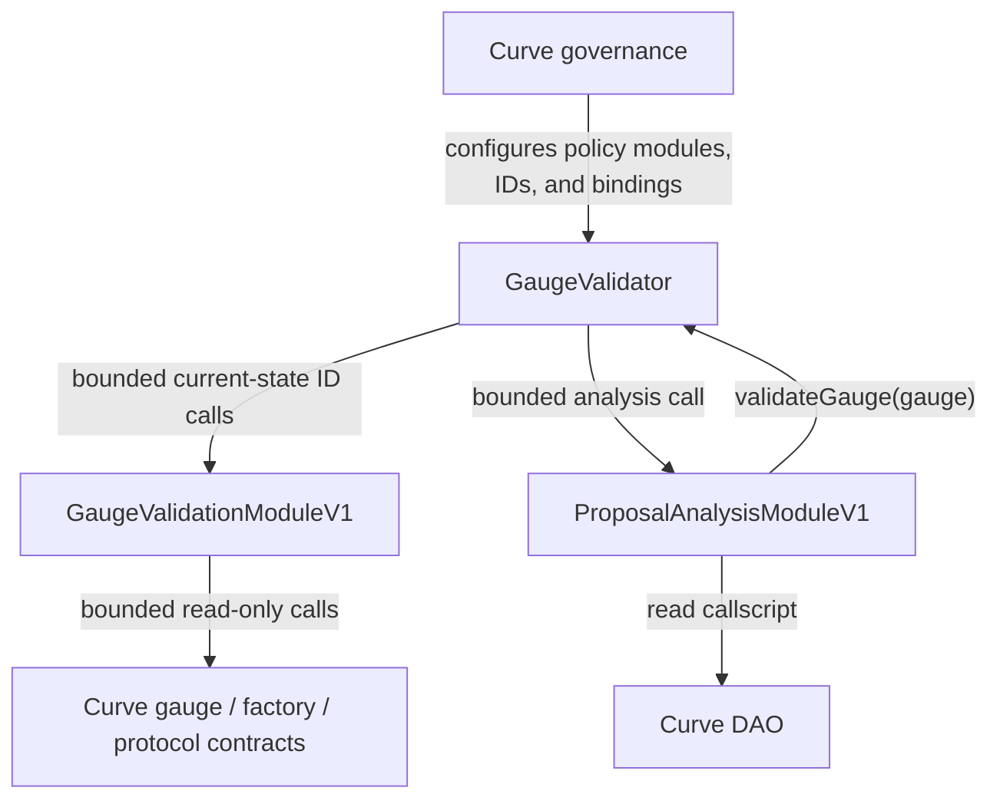
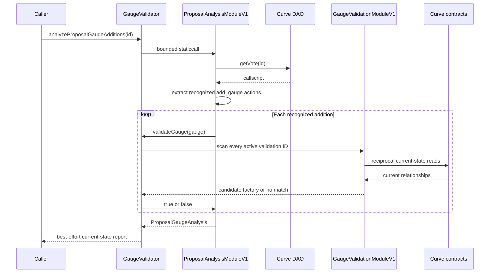

# Curve Gauge Validator Architecture

## Status and scope

This document defines the Ethereum implementation architecture for best-effort
validation of modern Curve gauges and current-state analysis of recognized
Curve DAO gauge additions.

The ordinary caller supplies only a gauge address:

```solidity
function validateGauge(address gauge) external view returns (bool);
```

The system is intentionally narrower than a universal GaugeController
validator:

- it targets gauges deployed through configured Curve factories;
- it authenticates them through current reciprocal factory relationships;
- it does not attempt to recover authenticity for ancient gauges deployed
  directly by EOAs;
- it does not predict state that an unexecuted proposal would create; and
- it does not evaluate or endorse unrelated proposal actions.

Unsupported, unavailable, ambiguous, and malformed checks fail closed.

## Design goals

- Keep ordinary validation a one-address boolean query.
- Validate present onchain relationships, not predicted future state.
- Require exactly one active validation ID to match.
- Keep protocol policy replaceable without upgrading the core.
- Make configuration idempotent and preserve dormant factory bindings.
- Group related validation methods instead of deploying an adapter per method.
- Make proposal analysis first class while naming its limited semantics
  honestly.
- Treat governance-selected modules as trusted policy components.
- Keep the implementation small enough to audit as a whole.

## Non-goals

- Exhaustive support for every historical GaugeController entry.
- Validation of EOA-deployed legacy gauges without factory provenance.
- GaugeController membership as proof of authenticity.
- Proposal-local state overlays for gauges created or configured by a proposal.
- Manually deployed LlamaLend liquidity-mining callbacks.
- Onchain governance simulation.
- Approval of an entire proposal.
- A generic proposal virtual machine.
- A public detailed gauge-resolution API.
- A proxy or `delegatecall`.
- An authorization boundary against Curve governance.

## Public interface

### Current gauge validation

```solidity
function validateGauge(address gauge) external view returns (bool);
```

The result means:

> At this block and under the current configuration, exactly one active
> validation ID authenticated this gauge through its exactly bound factory.

### Proposal gauge-addition analysis

```solidity
function analyzeProposalGaugeAdditions(uint256 proposalId)
    external
    view
    returns (ProposalGaugeAnalysis memory);
```

```solidity
enum AnalysisStatus {
    UNAVAILABLE,
    CALLSCRIPT_REJECTED,
    COMPLETE
}

struct GaugeAdditionAnalysis {
    address gauge;
    int128 gaugeType;
    uint256 initialWeight;
    bool currentlyValid;
}

struct ProposalGaugeAnalysis {
    AnalysisStatus status;
    bool allRecognizedGaugeAdditionsCurrentlyValid;
    GaugeAdditionAnalysis[] recognizedGaugeAdditions;
}
```

- `UNAVAILABLE`: the analyzer could not produce a result. The recognized-action
  array is empty and the aggregate is false.
- `CALLSCRIPT_REJECTED`: the analyzer ran, but the callscript violated its
  accepted grammar. The recognized-action array is empty and the aggregate is
  false.
- `COMPLETE`: every recognized gauge addition was evaluated against current
  state.

`COMPLETE` does not mean unrelated proposal actions were reviewed.
An individual gauge-policy failure remains a non-match for that gauge; it does
not make an otherwise completed proposal analysis unavailable.

`allRecognizedGaugeAdditionsCurrentlyValid` is false when the recognized array
is empty.

## System architecture

The deployment contains three contracts:



The read-only analyzer callback uses the same public boolean API as every other
caller. There is no detailed resolver interface and no special resolver
authorization.

### `GaugeValidator`

The stable, non-upgradeable core owns:

- one replaceable or disableable gauge-policy module pointer;
- active validation IDs;
- exact factory-to-ID bindings;
- zero/one/multiple match resolution;
- owner-controlled configuration;
- the active proposal-analysis module pointer;
- `validateGauge`; and
- `analyzeProposalGaugeAdditions`.

The core does not interpret validation IDs, factory-specific proof semantics,
or proposal syntax.

### `GaugeValidationModuleV1`

One immutable trusted policy module implements the initial current-state
validation methods:

- `DIRECT_LP`
- `DIRECT_OR_POOL_LP`
- `VAULT`
- `FACTORY_IS_VALID_GAUGE`

Combining these small read-only methods avoids unnecessary adapter contracts.
The module has no constructor configuration or protocol-specific immutables.
Governance may replace the complete gauge-policy module or set it to zero.

### `ProposalAnalysisModuleV1`

One immutable trusted policy module:

- reads the immutable Curve DAO voting app;
- parses the complete Aragon callscript framing;
- authenticates recognized direct and ownership-Agent-wrapped
  `GaugeController.add_gauge` calls;
- ignores structurally valid unrelated actions;
- evaluates recognized gauges through `GaugeValidator.validateGauge`; and
- returns actions in proposal order.

Curve governance may replace the analyzer or set it to zero to disable proposal
analysis.

## Trust model

Governance-selected modules are trusted policy components.

This means:

- a gauge module defines the semantics of its validation IDs;
- the proposal analyzer defines the supported callscript grammar;
- replacing either module is a governance policy upgrade; and
- the core does not attempt to make module interpretation trustless.

The core still enforces the orchestration invariants it owns:

- only the owner changes configuration;
- configured modules and factories require deployed code;
- factories bind to exact validation IDs;
- every active validation ID is scanned;
- ambiguity fails closed; and
- calls are gas bounded.

External protocol contracts read by a policy module are not trusted merely
because the module is trusted. The module must bound those reads, require
canonical return values, and fail closed on dependency errors.

## Validation-ID model

The core owns one current gauge-policy module and an active set of opaque
validation IDs. Each configured factory maps to one exact ID:

```text
factory -> validationId
```

`validationId` is an opaque, module-local method identifier. It is not a core
enum. The core does not select a method from the gauge; it passes every active
ID to the current module:

```solidity
module.factoryForGauge(gauge, validationId)
```

A returned factory counts only if it is bound to that exact ID.

Factory bindings may reference inactive IDs. Such bindings are dormant:
removing an ID disables all of its matches without deleting configuration, and
re-enabling the ID restores them. Replacing the gauge-policy module preserves
the active ID set and all factory bindings.

## Gauge-validation call flow

For `validateGauge(gauge)`:

1. Reject the zero address and addresses without deployed code.
2. Return false if gauge policy is disabled.
3. Iterate over every active validation ID.
4. Make a bounded call to
   `module.factoryForGauge(gauge, validationId)`.
5. Treat a revert, malformed return, zero factory, or exhausted gas allowance
   as no match.
6. Count the result only if the returned factory is bound to that exact ID.
7. Continue the complete scan after the first match.
8. Return true only if the final match count is exactly one.

```text
zero matching IDs -> false
one matching ID   -> true
multiple matches  -> false
```

Complete scanning makes the result independent of ID order and prevents an
overlapping policy from silently overriding another.

The active validation-ID cap is 16.

## Governance lifecycle

Curve governance can:

```solidity
addValidationId(bytes32 validationId);
removeValidationId(bytes32 validationId);
setFactoryValidationId(address factory, bytes32 validationId);
setGaugeValidationModule(address module);
setProposalAnalysisModule(address module);
transferOwnership(address newOwner);
```

Passing zero disables a factory:

```solidity
setFactoryValidationId(factory, bytes32(0));
```

Configuration operations are idempotent. Adding an active ID, removing an
inactive ID, restoring the current module, repeating a factory binding, or
transferring ownership to the current owner is a no-op. Constructor IDs are
also idempotent. Duplicate constructor factory entries are applied in order,
so the final entry wins.

Removing an ID never deletes a factory binding. The binding remains dormant
until the ID is re-enabled or the factory is rebound. Factories may be bound to
inactive IDs intentionally.

`setGaugeValidationModule(address(0))` disables gauge validation and
`setProposalAnalysisModule(address(0))` disables proposal analysis. A new
nonzero module requires deployed code. Configuration reverts only when the
requested state cannot be established, such as a zero owner, zero active ID,
missing module/factory code, or exceeding the ID cap.

## Current-state validation methods

Each method returns a candidate factory only after its reciprocal check
succeeds. The core separately requires that factory to be bound to the calling
validation ID.

### Direct LP

Used by the regular gauge factory and crvUSD StableSwap factory:

```text
factory = gauge.factory()
lpToken = gauge.lp_token()
require factory.get_gauge(lpToken) == gauge
return factory
```

### Direct or pool LP

Used by TwoCrypto NG, legacy TwoCrypto, metapool, stableswap proxy, and
tricrypto factories:

```text
factory = gauge.factory()
lpToken = gauge.lp_token()

if factory.get_gauge(lpToken) == gauge:
    return factory

pool = lpToken.minter()
require factory.get_gauge(pool) == gauge
return factory
```

The factory's reverse lookup establishes gauge authenticity. An additional
`get_token(pool)` round trip would add a dependency without strengthening that
relationship.

### Vault

Used by the lending gauge factory:

```text
factory = gauge.factory()
vault = gauge.lp_token()
require factory.gauge_for_vault(vault) == gauge
return factory
```

### Factory `is_valid_gauge`

Used by bridge, Fraxtal, root, and LlamaLend v2 vault-gauge factories:

```text
factory = gauge.factory()
require factory.is_valid_gauge(gauge) == true
return factory
```

The validation ID names the proof rather than any one gauge family. The proof
claims factory provenance only. LlamaLend-specific reciprocal market reads
would establish a stronger market-membership policy, but they are intentionally
outside this generic ID.

### LlamaLend v2 boundary

LlamaLend v2 markets do not require a gauge to operate. A positive borrow cap
and lender liquidity activate the lending path; a gauge only adds CRV
incentives.

The observed v2 gauge path is a conventional factory-deployed gauge over a
lender-vault token. It is authenticated exactly like every other
factory-attested gauge:

```text
gauge.factory() -> configured LlamaLend v2 gauge factory
factory.is_valid_gauge(gauge) -> true
```

The generic gauge factory permits a first deployment for an arbitrary token.
The validator therefore does not assert that every gauge from this factory is
a canonical LlamaLend market; it asserts only that the configured factory
created and attests the gauge.

Manually deployed borrower-side liquidity-mining callbacks are outside the
initial validator scope. If Curve later adopts them as a production gauge
family with durable provenance, governance can add a method or module at that
time.

## Proposal-analysis grammar

The analyzer requires the Aragon callscripts identifier:

```text
0x00000001
```

It recognizes a canonical direct call:

```text
GaugeController.add_gauge(gauge, gaugeType, initialWeight)
```

and a canonical ownership-Agent wrapper:

```text
Agent.execute(
    GaugeController,
    0,
    GaugeController.add_gauge(gauge, gaugeType, initialWeight)
)
```

The parser verifies:

- complete callscript framing and byte consumption;
- authenticated outer and inner targets for recognized actions;
- exact recognized calldata lengths;
- canonical ABI offsets, address words, and signed `int128` extension;
- dynamic byte lengths and zero padding;
- zero ETH value for recognized wrapped actions; and
- absence of recursive Agent wrappers.

Structurally valid unrelated actions are ignored. Gauge-shaped calls through
incorrect targets, malformed recognized wrappers, truncated calls, trailing
fragments, or malformed later recognized actions reject the complete analysis.
Earlier partial results are never exposed.

The recognized-action cap is 64.

## Current-state proposal semantics

For every recognized gauge addition, the analyzer calls:

```solidity
validator.validateGauge(gauge)
```

It does not return internal policy attribution. The action report contains only
the proposal arguments and the current boolean result.



### No proposal-local future state

Consider:

```text
1. Factory deploys or configures a gauge
2. GaugeController.add_gauge(gauge)
```

The analyzer ignores the unrelated factory action and evaluates the gauge as it
exists at the queried block. If the reciprocal factory relationship does not
yet exist, `currentlyValid` is false.

That is not treated as a validator defect. Any conclusion that depends on
proposal-created state requires pinned-fork execution of the complete payload,
followed by `validateGauge` against post-execution state.

## Module-call boundary

Because the active modules are trusted policy components, the core does not
maintain a second semantic implementation of their output.

For the proposal analyzer:

- the core uses a typed, gas-bounded call;
- disabled module or call failure returns `AnalysisStatus.UNAVAILABLE`;
- the trusted analyzer enforces the 64-action bound and result consistency;
- the core does not manually scan ABI words or recompute analyzer policy; and
- ABI compatibility is verified before governance activates a replacement.

For gauge validation:

- the existing small fixed-size call boundary remains gas bounded;
- it accepts only one canonical returned address;
- an ID call failure is treated as no match; and
- the core still enforces exact factory binding and ambiguity because those are
  core-owned orchestration rules.

Policy modules continue to strictly validate return data from untrusted protocol
dependencies.

## Factory-first scope

The intended provenance is:

```text
configured Curve factory
        |
        v
factory-deployed gauge
        |
        v
reciprocal factory relationship
        |
        v
validateGauge(gauge)
```

A future gauge should validate when:

1. it is deployed through a supported Curve factory;
2. the applicable validation method is active;
3. the factory is bound to that exact validation ID; and
4. its reciprocal relationship is readable at the queried block.

A new factory requires governance configuration. Unknown factories are not
trusted automatically.

An EOA-deployed historical gauge may return false even if GaugeController
contains it. That is an intentional scope boundary.

## Ethereum deployment configuration

| Factory family | Factory | Validation ID |
| --- | --- | --- |
| Regular gauge factory | `0x6A8cbed756804B16E05E741eDaBd5cB544AE21bf` | `DIRECT_LP` |
| crvUSD StableSwap factory | `0x4F8846Ae9380B90d2E71D5e3D042dff3E7ebb40d` | `DIRECT_LP` |
| TwoCrypto NG factory | `0x98EE851a00abeE0d95D08cF4CA2BdCE32aeaAF7F` | `DIRECT_OR_POOL_LP` |
| Legacy TwoCrypto factory | `0xF18056Bbd320E96A48e3Fbf8bC061322531aac99` | `DIRECT_OR_POOL_LP` |
| Metapool factory | `0xB9fC157394Af804a3578134A6585C0dc9cc990d4` | `DIRECT_OR_POOL_LP` |
| Stableswap proxy | `0x855cC906dA8271Dd53879929bd226711247D5f17` | `DIRECT_OR_POOL_LP` |
| Tricrypto factory | `0x0c0e5f2fF0ff18a3be9b835635039256dC4B4963` | `DIRECT_OR_POOL_LP` |
| Lending gauge factory | `0xeA6876DDE9e3467564acBeE1Ed5bac88783205E0` | `VAULT` |
| Bridge gauge factory | `0xabC000d88f23Bb45525E447528DBF656A9D55bf5` | `FACTORY_IS_VALID_GAUGE` |
| Fraxtal gauge factory | `0xeF672bD94913CB6f1d2812a6e18c1fFdEd8eFf5c` | `FACTORY_IS_VALID_GAUGE` |
| Root gauge factory | `0x306A45a1478A000dC701A6e1f7a569afb8D9DCD6` | `FACTORY_IS_VALID_GAUGE` |
| LlamaLend v2 vault-gauge factory | `0x64e1a69732fAC63F6790b3d8a34C5D713cC623E6` | `FACTORY_IS_VALID_GAUGE` |

Canonical dependencies:

| Dependency | Address |
| --- | --- |
| Curve DAO voting app | `0xE478de485ad2fe566d49342Cbd03E49ed7DB3356` |
| Curve ownership Agent and validator owner | `0x40907540d8a6C65c637785e8f8B742ae6b0b9968` |
| GaugeController | `0x2F50D538606Fa9EDD2B11E2446BEb18C9D5846bB` |

### Pinned LlamaLend v2 evidence

At Ethereum block `25,619,622`
(`0x3995ff2d82e9b602f8c36a4b408e13bcda78dfdebd79e3ff87c89044569ec059`,
`2026-07-26T21:20:47Z`):

- factory `0x64e1…23E6` is owned by the Curve ownership Agent;
- gauge `0xbe04…A14e` reports that factory and the factory returns
  `is_valid_gauge(gauge) == true`;
- the gauge's LP token is the syrupUSDC LlamaLend v2 lender vault, whose
  `factory()` is the canonical v2 LendFactory; and
- ownership proposal `1461` contains borrow-cap and admin-percentage actions
  followed by `GaugeController.add_gauge(0xbe04…A14e, 0, 0)`.

The gauge was deployed before the proposal. Proposal execution may atomically
bundle market activation and gauge registration, but a gauge is not a market
runtime dependency. The factory permits a first gauge deployment for an
arbitrary token and does not itself prove LlamaLend market membership.
Accordingly, this policy proves generic factory provenance; the observed gauge
happens to wrap a canonical v2 lender vault. This live path justifies binding
the factory to the generic attestation ID rather than labeling the proof as
LlamaLend-specific validation.

The deployment creates three contracts in three transactions. The core is fully
configured and owned by Curve governance from construction. If either module
deployment succeeds but a later transaction fails, the unreferenced immutable
module is harmless and the deployment can be retried; a deployer contract is
not warranted solely to make these creations atomic.

## Failure and gas model

- The core forwards a fixed gas allowance to each validation-ID call.
- The core reserves enough gas to attempt every remaining ID.
- A module or dependency failure contributes no match.
- The proposal-analysis call is gas bounded.
- A disabled or reverting analyzer produces `UNAVAILABLE`.
- Policy modules bound every read from untrusted protocol dependencies.
- Insufficient information returns false or unavailable, never true.

## Advisory role

The system supports monitoring, drafting, and governance review. It is not an
independent authorization system against Curve governance.

Curve governance controls:

- active policy modules;
- active validation IDs;
- factory bindings; and
- the decisions that consume the result.

Every result is relative to a block and configuration. Consumers should record
the chain ID, block hash, core address, active module addresses, and relevant
configuration events.

## Testing and evidence

Release gates should emphasize the supported factory-first model:

- idempotent configuration operations;
- duplicate constructor bindings with last-entry-wins behavior;
- dormant bindings and ID removal/re-enabling;
- gauge-policy replacement and disabling;
- exact factory-to-ID binding;
- zero, one, and multiple matches;
- every module and dependency failure returning false;
- analyzer unavailable, rejected, and complete outcomes;
- deployed code and exact bindings for every configured factory;
- representative factory-deployed gauges from every supported factory family;
- spoofed self-reported factories and reciprocal failures;
- the LlamaLend v2 vault gauge proposed in ownership vote `1461`;
- strict direct and Agent-wrapped `add_gauge` parsing;
- malformed recognized-action rejection;
- analyzer replacement, removal, revert, and gas exhaustion;
- three-transaction deployment and exact configuration readback; and
- pinned-fork proposal execution whenever analysis depends on proposed state.

Historical manifests may remain useful research and regression artifacts, but
they are not normative policy. Exhaustive historical gauge or proposal
coverage is not required:

- the system does not promise correct classification of every historical
  GaugeController gauge;
- EOA-deployed legacy gauges may remain unsupported; and
- unsupported historical proposal patterns do not automatically expand the
  parser grammar.

Reference observations should still record chain ID, block hash, timestamp,
addresses, methods, and units.

## Implementation map

- `src/GaugeValidator.sol`: stable core, validation-ID lifecycle, exact
  factory bindings, boolean resolution, policy pointers, and public
  entrypoints.
- `src/GaugeValidationModuleV1.sol`: four initial current-state gauge policies.
- `src/ProposalAnalysisModuleV1.sol`: strict recognized-action extraction and
  current-state gauge analysis.
- `src/interfaces/IGaugeValidationModule.sol`: gauge-policy boundary.
- `src/interfaces/IProposalAnalysisModule.sol`: proposal-analysis boundary.
- `src/MainnetGaugeConfiguration.sol`: initial Ethereum IDs and bindings.
- `script/DeployGaugeValidator.s.sol`: three-contract deployment with a fully
  configured, governance-owned core.
- `script/InspectGaugeValidator.s.sol`: configuration readback.
- `script/AnalyzeProposalGaugeAdditions.s.sol`: proposal inspection.
- `test/`: focused unit, adversarial-dependency, deployment, representative
  pinned-gauge, parser, and simulation tests.

## Final design rule

```text
GaugeValidator
    owns stable configuration and exactly-one-match semantics

GaugeValidationModuleV1
    owns current protocol identity policy

ProposalAnalysisModuleV1
    owns recognized proposal syntax and current-state reporting

Pinned-fork simulation
    owns proposal-created future state
```

Add another contract or abstraction only when a real trust boundary or
independent policy lifecycle requires it.

The operational rule is:

```text
validation failures return false or an explicit analysis status
configuration reverts only when governance's requested state cannot be established
```
