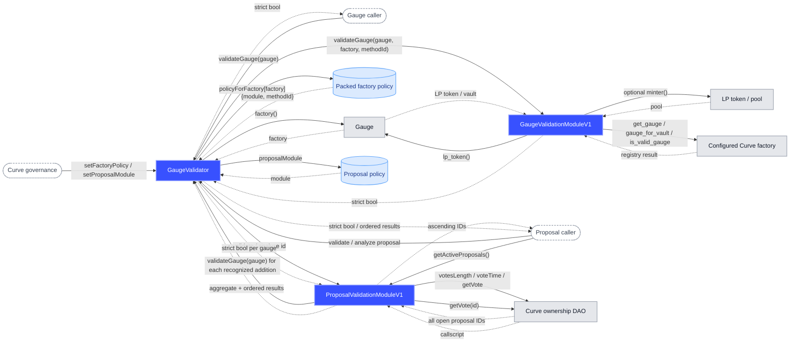

# Curve Gauge Validator Architecture

## Questions

One stable `GaugeValidator` address answers:

> Was this gauge deployed by a trusted factory?

> Do all authenticated gauge additions in this proposal use a standard zero
> initial weight and currently pass that predicate?

```solidity
function validateGauge(address gauge) external view returns (bool);
function validateProposalGauges(uint256 proposalId) external view returns (bool);
function analyzeProposalGauges(uint256 proposalId)
    external
    view
    returns (bool allValid, GaugeResult[] memory results);
```

`GaugeValidator` keeps one O(1) factory-policy mapping and one replaceable
proposal-module pointer. Proof logic and proposal parsing remain outside the
entry point. The proposal module separately enumerates every currently open
ownership proposal without filtering by callscript contents.

## Contract call flows



Blue boxes are contracts in this repository. Light-gray boxes are external
onchain contracts, pill shapes are callers or governance, and the cylinder is
core storage. Solid arrows are calls or reads; dashed arrows are returned
values.

`ProposalValidationModuleV1` does not call the ownership Agent or
GaugeController. It authenticates their addresses and calldata inside the DAO
callscript. Active-proposal discovery calls the module directly after reading
its address from `GaugeValidator.proposalModule()`. The stable entry point calls
the configured proposal module for analysis, and the module calls that same
entry point's `validateGauge` method for every recognized addition.

## Rule

`validateGauge(gauge)` returns `true` only when:

1. `gauge` is a contract;
2. `gauge.factory()` returns a canonical nonzero address;
3. that address has an exact packed `{module, methodId}` policy; and
4. the configured module validates the gauge against that exact factory and
   validation method.

Every failed, reverting, malformed, gas-exhausting, contradictory, or
unconfigured read returns `false`.

```text
gauge
  |
  +-- no code or unreadable factory() ----------------------> false
  |
  +-- factory has no configured module ---------------------> false
  |
  +-- bounded module call fails or is malformed ------------> false
  |
  +-- module rejects the gauge/factory relationship --------> false
  |
  `-- module validates the gauge/factory relationship ------> true
```

Reading `gauge.factory()` alone is insufficient because any contract can
self-report a trusted address. The reciprocal check is what proves factory
provenance.

## Gauge contract

`GaugeValidator` contains:

- `mapping(address factory => FactoryPolicy) policyForFactory`;
- one owner-replaceable `proposalModule`;
- a bounded, strict `gauge.factory()` read;
- a bounded, strict policy-module call;
- governance ownership; and
- stable gauge, aggregate-proposal, and detailed-proposal entry points.

The binding is:

```solidity
struct FactoryPolicy {
    address module;
    uint8 methodId;
}
```

The structure occupies one storage slot. Method IDs are module-local; the core
stores and forwards them without interpreting a global enum. Zero is reserved.
An active policy is exactly `{nonzero module, nonzero methodId}`, and a disabled
factory is exactly `{address(0), 0}`. Noncanonical pairs revert, so dormant
policy state cannot exist. There is no route scan, module registry, active-ID
lifecycle, ambiguity state, or caller-supplied factory hint.

The core reads `gauge.factory()` once, selects the exact factory policy, and
passes the reported factory to the module. Because modules are
governance-selected trusted policy components, the module returns a strict
boolean. The core accepts only an exact ABI-encoded zero or one.

Governance may bind, rebind, or revoke one factory:

```solidity
setFactoryPolicy(address factory, address module, uint8 methodId);
```

Each update emits only the resulting `FactoryPolicySet(factory, module,
methodId)` policy. A zero module and zero method ID record removal.

Governance may separately replace or disable the proposal parser:

```solidity
setProposalModule(address module);
```

Each update emits `ProposalModuleSet(module)`. A zero module disables proposal
validation, whose entry points then revert with `ProposalModuleUnavailable`.
This lets future factory proofs and proposal parsers change without replacing
the stable public entry point.

## Current policy module

`GaugeValidationModuleV1` is immutable, stateless, and implements the four
current reciprocal method IDs:

```text
1  DIRECT_LP
2  DIRECT_OR_POOL_LP
3  VAULT
4  FACTORY_IS_VALID_GAUGE
```

Unknown or zero IDs and every failed dependency return `false`.

### Direct LP

```text
lpToken = gauge.lp_token()
factory.get_gauge(lpToken) == gauge
```

### Direct or pool LP

```text
lpToken = gauge.lp_token()

factory.get_gauge(lpToken) == gauge
    OR
factory.get_gauge(lpToken.minter()) == gauge
```

The pool fallback is attempted only when the direct lookup succeeds and
returns zero. A failed or contradictory direct lookup returns `false`.

### Vault

```text
vault = gauge.lp_token()
factory.gauge_for_vault(vault) == gauge
```

### Factory attestation

```text
factory.is_valid_gauge(gauge) == true
```

All dependency calls are capped at 30,000 gas. Address responses must be
exactly 32 bytes with zero upper bits. Boolean responses must be exactly 32
bytes and equal to zero or one.

The core caps each module call at 2,000,000 gas and requires an exact canonical
boolean response. Policy modules are trusted, governance-selected policy
components, but calls remain bounded and fail closed so a broken module cannot
make the validator revert or exhaust the caller's gas. Policy modules should
be immutable implementations; binding an upgradeable proxy deliberately
transfers policy-change authority to that proxy's administrator.

## Proposal module

`ProposalValidationModuleV1` is a separate stateless policy module. It stores
only:

- the Curve ownership DAO;
- the ownership Agent;
- GaugeController.

The proposal module itself exposes:

```solidity
function getActiveProposals() external view returns (uint256[] memory proposalIds);
```

This returns every currently open ownership proposal in ascending ID order,
including proposals with no gauge actions. Proposal IDs are chronological, so
the module walks backward only until `startDate + voteTime <= block.timestamp`,
then returns each `open` vote in that current window. Recently executed votes
are skipped but do not terminate discovery. The callscript is never read to
decide whether a proposal belongs in this list, and memory use is bounded by
the current voting window rather than all historical proposals.

At Ethereum block `25,619,622`
(`0x3995ff2d82e9b602f8c36a4b408e13bcda78dfdebd79e3ff87c89044569ec059`,
`2026-07-26T21:20:47Z`), the pinned-fork test returns every open ownership
proposal: IDs `1455` through `1461`.

The stable `GaugeValidator` entry point exposes:

```solidity
function validateProposalGauges(uint256 proposalId) external view returns (bool);

struct GaugeResult {
    address gauge;
    bool valid;
}

function analyzeProposalGauges(uint256 proposalId)
    external
    view
    returns (bool allValid, GaugeResult[] memory results);
```

The boolean answers:

> Do all executable authenticated gauge additions use a standard zero initial
> weight and currently pass the trusted-factory predicate?

`true` means yes. `false` means at least one authenticated addition uses a
nonzero initial weight, fails gauge validation, or cannot be decoded safely.
A proposal with no gauge additions returns `true` because it creates no gauge
risk. Consumers must pair that boolean with the result length: `(true, [])`
means gauge validation is not applicable and does not endorse unrelated
proposal actions.

Off-chain consumers can derive presentation status without another on-chain
enum:

| `allValid` | Result length | Meaning |
| --- | --- | --- |
| `true` | nonzero | `valid` |
| `false` | nonzero | `invalid` |
| `true` | zero | `not_applicable` |
| `false` | zero | `unsupported` |

DAO or module reverts remain outer call failures rather than a manufactured
status.

The detailed method returns one result for every safely decoded authenticated
gauge addition, preserving proposal order and duplicates. Each item answers
whether that specific addition uses standard zero weight and its gauge
currently passes `validateGauge`. A canonical nonzero-weight addition includes
its decoded gauge with `valid == false`. An authenticated call that is too
malformed to identify a gauge safely makes `allValid == false` without
inventing a result address.

The validator recognizes both executable GaugeController encodings:

- `add_gauge(address,int128)`, whose omitted initial weight defaults to zero;
  and
- `add_gauge(address,int128,uint256)`, only when the explicit initial weight
  is zero.

Each encoding is recognized only when it is either a direct canonical
GaugeController call or the exact payload of a canonical ownership-Agent
`execute` call whose inner target is GaugeController and value is zero.
Nonzero initial weight deliberately returns `false`: registration remains a
zero-weight operation, while any later weight allocation stays explicit and
separate.

Unrelated calls and gauge-shaped calls through any other target are ignored.
An Agent wrapper aimed anywhere other than GaugeController, or carrying
nonzero value, also cannot perform the authenticated zero-value addition and
is ignored.

Structural callscript failures such as a truncated script, a truncated call
header, or an out-of-bounds call length make the entire proposal
non-executable. They therefore return `true`, even if an earlier call would
have failed gauge validation; detailed analysis returns an empty result array.
An unknown script-executor ID returns `false` with an empty array because
another registered executor may be able to run it. Once the callscript is
structurally executable, gauge-shaped calls at the authenticated targets must
use canonical calldata. Noncanonical words, malformed authenticated wrappers,
and recursive Agent execution return `false` pessimistically.

The proposal module treats its caller as the validator. In normal use that
caller is the configured stable `GaugeValidator`, so there is no circular
deployment dependency or validator address embedded in the module. Every
recognized gauge is evaluated through that caller with a 2,100,000-gas cap and
an exact canonical boolean return. The extra 100,000 gas lets the entry point
perform its factory read and still forward the full 2,000,000-gas gauge-module
budget under EIP-150. A failed query makes that gauge invalid. There is no
arbitrary recognized-gauge cap.

The DAO read is capped at 5,000,000 gas and failures revert the proposal
validation call. RPC transport failures likewise fail the outer call rather
than becoming an on-chain result.

Gauge booleans reflect the current block. The proposal module does not simulate
state changes that earlier calls in the proposal would create.

## Mainnet trust set

All initial bindings use `GaugeValidationModuleV1`.

| Factory family | Factory | Method |
| --- | --- | --- |
| Regular gauge factory | `0x6A8cbed756804B16E05E741eDaBd5cB544AE21bf` | `DIRECT_LP` |
| crvUSD StableSwap factory | `0x4F8846Ae9380B90d2E71D5e3D042dff3E7ebb40d` | `DIRECT_LP` |
| TwoCrypto NG factory | `0x98EE851a00abeE0d95D08cF4CA2BdCE32aeaAF7F` | `DIRECT_OR_POOL_LP` |
| Legacy TwoCrypto factory | `0xF18056Bbd320E96A48e3Fbf8bC061322531aac99` | `DIRECT_OR_POOL_LP` |
| Metapool factory | `0xB9fC157394Af804a3578134A6585C0dc9cc990d4` | `DIRECT_OR_POOL_LP` |
| Tricrypto factory | `0x0c0e5f2fF0ff18a3be9b835635039256dC4B4963` | `DIRECT_OR_POOL_LP` |
| Lending gauge factory | `0xeA6876DDE9e3467564acBeE1Ed5bac88783205E0` | `VAULT` |
| Bridge gauge factory | `0xabC000d88f23Bb45525E447528DBF656A9D55bf5` | `FACTORY_IS_VALID_GAUGE` |
| Fraxtal gauge factory | `0xeF672bD94913CB6f1d2812a6e18c1fFdEd8eFf5c` | `FACTORY_IS_VALID_GAUGE` |
| Root gauge factory | `0x306A45a1478A000dC701A6e1f7a569afb8D9DCD6` | `FACTORY_IS_VALID_GAUGE` |
| Generic factory used by LlamaLend v2 vault gauges | `0x64e1a69732fAC63F6790b3d8a34C5D713cC623E6` | `FACTORY_IS_VALID_GAUGE` |

## LlamaLend v2 boundary

At Ethereum block `25,619,622`,
`0xbe0451815b546F705ef3f398B8179aE3AADDA14e` reports the configured generic
gauge factory, and that factory returns `is_valid_gauge(gauge) == true`.

That proves the gauge came from the trusted generic factory. It does not prove
that the LP token belongs to a canonical LlamaLend market. The generic factory
can create a first gauge for an arbitrary token, so market membership is a
different question and deliberately out of scope.

## Deployment and verification

Deployment is three CREATE2 transactions through the canonical CreateX
factory. The stateless modules are deployed first because their addresses are
embedded in the core's constructor arguments:

```text
0x999902533033Cc63c8128C501e307477932B742E  GaugeValidationModuleV1
0x9999032142B45AE92e11a5E10A45F49f58b67773  ProposalValidationModuleV1
0x999901cd8568Caafeb8888F18C1F5B870B58b7F2  GaugeValidator
```

Each raw salt is permissioned to the deployment account and protected for
Ethereum chain ID 1. The proposal-module init code includes its DAO, Agent,
and GaugeController arguments; the core init code includes governance, the
proposal module, and all initial factory policies. Exact init-code hashes
therefore bind the vanity addresses to both the compiled contracts and their
constructor configuration. The deployment script checks the canonical CreateX
runtime hash, recomputes every init-code hash and target address, rejects
unexpected target code, and safely skips an already deployed component only
when its runtime hash matches.

Both modules are stateless and have no owner or policy configuration. The
deployment script reads back every immutable proposal dependency, the stable
entry point's owner and proposal module, and each factory's exact module and
method ID.

Tests cover:

- all four proof layouts;
- rebinding a factory to a future module without replacing the core;
- every module failure and malformed return;
- untrusted and spoofing cases;
- reverting, malformed, gas-burning, and oversized return data;
- owner-only trust changes;
- replacing and disabling the proposal module without changing the entry
  point;
- direct and Agent-wrapped proposal additions using both executable
  `add_gauge` encodings;
- all open ownership proposals in ascending order, independent of their
  callscript contents, with exact voting-window boundaries;
- explicit zero weight, rejected nonzero weight, empty proposals, malformed
  authenticated calls, and mixed-validity aggregate results;
- ordered 2-of-3 results, duplicate preservation, nonzero-weight attribution,
  and more than 64 detailed results;
- representative live gauges for every configured factory family;
- every open ownership proposal and two representative gauge proposals at a
  pinned mainnet block;
  and
- exact three-contract deployment and stable-entrypoint readback on a pinned
  mainnet fork.

Exhaustive historical gauge or proposal coverage is not required.
